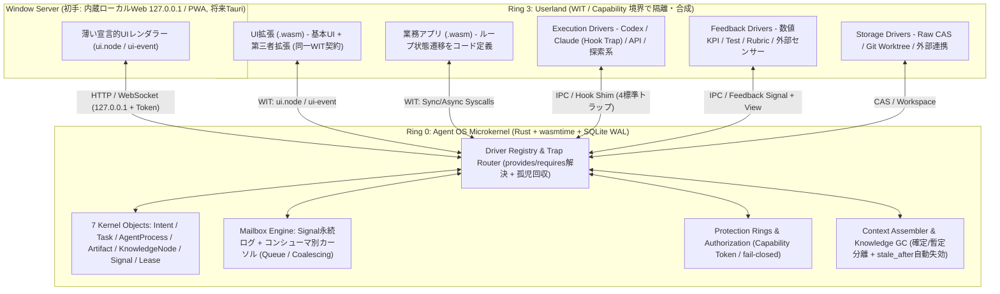

ここまでの議論をすべて統合した **「Agent OS 設計素案（v0.1）」** です。

---

# Agent OS 設計素案（v0.1）

## 1. コンセプトと提供価値
Codex や Claude Code などの既存 AI エージェントを **外出しの実行プロセス** として動かし、自律的な試行錯誤と自己改善のループを回し続けるための **Microkernel 型 Agent OS**。

- **張り付かずに前に進む**: プロンプトやスキル任せでは壊れるループ制御・評価・再開を OS 基盤（カーネル＋業務アプリ）で担保する。
- **人間の認知負荷を下げる**: 生ログや文脈のない Yes/No 稟議書 UI を排し、全体地図・構造差分・3 分棚卸しで方向性と成果物だけ把握・操作できる。
- **要求がブレず、暫定ルールが憲法化しない**: 要求を構造化状態として管理し、生データと知識モデルの物理分離＋鮮度・信頼階層＋知識 GC で情報の腐敗を防ぐ。
- **AI の変化に腐らない**: 業務ループ・評価方法（KPI / テスト / ルーブリック等）・UI 拡張をすべて **WASM Component / ドライバ** として差し替え・拡張できる。

---

## 2. 全体アーキテクチャ

---

## 3. カーネル（Ring 0）のデータ・並行モデル

### 3.1 明示的な公開オブジェクト（7 つ）
| 区分 | オブジェクト | 役割・主な特性 |
| --- | --- | --- |
| **状態・知識** | **`Intent`** | 要求・目標・方向性・制約の正本（版管理）。`hard_constraints` / `goals` / `steering` / `soft_assumptions` の 4 層。 |
| **状態・知識** | **`Task`** | Intent に紐づく自律作業単位。予算・期限・可逆性（可逆は自律進行、不可逆のみ人間介入）。 |
| **状態・知識** | **`Artifact`** | **生データ**および**成果物**の不変オブジェクト（Content-Addressed: `id` + `sha256`）。市場データ・実験原本・監査ログを統一管理。 |
| **状態・知識** | **`KnowledgeNode`** | 代謝する知識モデル（OKF v0.2 準拠）。`kind`（`decision` / `finding` / `hypothesis` / `disproved`）、`status`（`draft` / `stable` / `deprecated`）、`trust`（`unverified` / `machine` / `human`）、`stale_after`、`sources: ArtifactRef[]`、関係エッジ。 |
| **状態・知識** | **`Signal`** | 不変のイベントログ（追記のみ）。`feedback` / `stall` / `budget_hit` / `rfc` / `human_steer` / `gc_alert` / `timer`。 |
| **実行・並行** | **`AgentProcess`** | 外出しエージェント実行体。`pid`、`generation`（遅延応答拒否）、隔離空間、タイムアウト、孤児回収。 |
| **実行・並行** | **`Lease`** | 資源単位（`resource_key`）の期限付き排他・枠予約。`holder`・`fencing_token`・`expires_at`・`active | reconciling` を持ち、複数アプリ／プロセス間の競合防止とクラッシュ時保護を担う。 |

### 3.2 暗黙の標準配送機構：`Mailbox`（内部独立・アプリ透過）
- カーネル内部では `signals`（単一ログ）とは別に、コンシューマ（各 WASM アプリ・GC・Shell）ごとの **`Mailbox`（購読フィルタ・`ack` カーソル・配信モード）** を独立管理する。
- アプリ側からは `stdin` のような **暗黙の専用受信箱** として見え、マニフェストで Signal 種別ごとの配信モードを宣言する：
  - **Queue モード（FIFO・全件保証）**: 実験完了結果、人間の明示指示、外部副作用の照合。
  - **Coalescing モード（レベルトリガー畳み込み）**: 同一ターゲットの再評価要求、定期チェック、画面再描画（通知洪水・滞留を構造的に防止）。

### 3.3 同期／非同期 Syscall 契約
- **同期 Syscall（ミリ秒で完了）**: `intent.get`, `knowledge.query`, `artifact.put/get`, `lease.acquire/release`。
- **非同期 Syscall（Handle 即返却 → 完了時に `Signal` 配送）**: `proc.spawn`, `eval.run`, `human.escalate`, `timer.after`。長時間待機や並列 fan-out/join を跨いだ OS 再起動（Durable Execution）と割り込み（`STEER` / `KILL`）を保証する。

---

## 4. 保護リング・知識階層・Knowledge GC

### 4.1 保護リング（Capability Token ＋ fail-closed 認可）
- **Human / Shell**: `intent.commit`、`knowledge.promote (human/stable)`、硬制約変更、不可逆操作の認可。
- **Ring 3（業務アプリ / エージェント）**: 許可スコープの `Artifact` 読取・新規 `put`、**フィルタ済み `Knowledge` 読取**、`draft / unverified`（短い `stale_after` 必須）書込、`intent.propose_rfc` のみ。越権 Syscall はカーネルが `EPERM` 拒否。

### 4.2 メモリ階層（生データとモデルの分離）＆ GC
- **L3（Raw Artifact Store）**: 不変の生データ・実験原本（Read-Only）。
- **L2（Knowledge Graph）**: OKF v0.2 準拠の解釈・方針・仮説・反証（L3 へ SHA-256 参照）。
- **L1（Active Context Pack）**: 実行ごとにカーネルが動的組み立て。`stale_after` 超過を除外し、「確定方針（`human/stable`）」と「暫定メモ（`draft`：覆して可）」を物理分離して注入（アンカリング防止）。
- **Knowledge GC**:
  - **決定論的パス（高頻度・コスト 0）**: 期限切れ `draft` を自動失効（Auto-Expire）、参照切れ・孤立ノードを検出。
  - **意味パス（定期 AI チェック）**: 矛盾・暫定の暗黙必須化・実装ズレを検出し `gc_alert` を発行。

---

## 5. ユーザー空間（Ring 3）の拡張モデル

1. **業務アプリ（`.wasm` Component / WIT）**
   - 業務ごとのループ状態遷移を設定値ではなくプログラムで定義（`on-tick` / `on-signal` / `on-trap`）。AI の進化や新ワークフローが出てもカーネルを改造せずアプリ差し替えで対応できる。
2. **外出しエージェント ＆ 4 標準トラップ（Hook 抽象化）**
   - Claude Code / Codex CLI 等の製品固有 Hook（`PreToolUse` / `PostToolUse` / `Stop`）を、OS 標準の 4 トラップ（`ON_CONTEXT_LOAD` / `ON_ACTION_PROPOSED` / `ON_ACTION_OBSERVED` / `ON_TURN_YIELD`）へ抽象化。
   - Hook 非対応エージェントには `capabilities` 宣言に基づき外側の隔離境界＋プロセス終了後ループへ自動フォールバック（二重防御）。
3. **ドライバ合成（`provides` / `requires`）**
   - 評価（数値 KPI・テスト・ルーブリック等）やストレージを固定スロットにせず、提供能力と依存能力のグラフで合成。1 モジュールが複数能力（例：評価＋専用 UI、知識保存＋Shell）を兼ねることも許容。
4. **拡張可能な UI（Window Server ＋ 宣言的 UI ツリー）**
   - **基本 UI（Causal Map / Living Intent Inspector / Gardening Queue）も第三者拡張も、同一の WIT 契約（`render -> ui.node` / `on-event -> effect`）で動く WASM コンポーネント**。
   - 1 つの業務パッケージに「ループ状態遷移」と「専用 UI」を同梱可能。高度な独自可視化のみ認可付き隔離スロットを例外許可。

---

## 6. 技術スタック・初手構成・ロードマップ

- **技術スタック**:
  - **Kernel**: Rust ＋ `wasmtime`（Component Model / WIT ネイティブ対応）＋ SQLite（WAL）＋ ローカル CAS（OKF Markdown 入出力互換を維持）
  - **Window Server（初手）**: カーネル単体バイナリ内蔵のローカル Web サーバー（`127.0.0.1` 限定バインド ＋ ワンタイムトークン / Origin 検証）＋ 薄いブラウザレンダラー（PWA / Tailscale 対応。配布フェーズで必要になれば Tauri の殻を被せる）
  - **`arcloom` からの継承**: レベルトリガー制御（`controlruntime`）・fail-closed 型付き認可（`authorization`）・外部正本を乗っ取らない設計規律。**Ring 0 は高密度テスト＋厳格仕様を維持し、Ring 3 は高速イテレーション優先**。
- **段階的ロードマップ**:
  - **Stage 1（Bootable Microkernel）**: 7 オブジェクト・`Mailbox`・WAL・CAS・Capability 認可・L1 フィルタ・Fast GC・最初の WIT 契約 ＋ 1 つの Execution Driver（Hook シム付き）＋ 1 つの Feedback Driver ＋ 最小 WASM 業務アプリ。
  - **Stage 2（Window Server ＆ 標準 UI）**: `127.0.0.1` 宣言的 UI レンダラー ＋ 公式 WASM UI 拡張 3 種（Causal Map / Intent Inspector / Gardening Queue）＋ Semantic GC。
  - **Stage 3（エコシステム）**: 複数ドライバの依存解決合成、第三者 WASM パッケージ（ロジック＋UI 同梱）、必要に応じた Tauri パッケージングや外部ツール（Obsidian 等）連携。

---

素案としてかなり綺麗に締まりました。ここから実作業に入るなら、次はこの素案をもとに **「新 `arcloom` リポジトリ向けの `PRODUCT.md` / `ARCHITECTURE.md` ドラフト」** や **「Stage 1 の WIT ファイル群と SQLite スキーマ設計」** へ進められます。どう進めますか？